> [!IMPORTANT]
> Hello,
>
> I like tech, gaming, and finding ways to make repetitive tasks less annoying. My background is in aviation and technical troubleshooting. I’ve created tools for sorting through logs, cleaning up data, and helping with office tasks, and I’m still working on more.
>
> I’m also very interested in computers and have built many of them, including the one I’m using right now. I enjoy choosing the parts, putting everything together, and getting a system running.
>
> I keep up with developments in technology and AI because I’m curious about what’s becoming possible and what I could try building next. I also follow the finance world, particularly mergers, acquisitions, and the news that sends stocks moving.
>
> Video games are a big interest of mine. I enjoy multiplayer games, and I’ve also made quality of life programs for single player games to spend less time on mundane tasks and more time actually playing.
>
> Feel free to reach out about work, collaborations, project ideas, gaming, or anything else. I’m always open to a conversation.

 

## Things I’m building

| Project | What it does |
| :--- | :--- |
| [Log Detective](https://github.com/Geezusotl/log-detective) | Helps investigate application logs, connects findings to evidence, and prepares troubleshooting reports. |
| [CSV Doctor](https://github.com/Geezusotl/csv-doctor) | Explains potential problems in CSV files and creates a separate cleaned copy while keeping the original intact. |
| Arknights Tools · Private project | Auto Recruit handles recruitment routines, and Duel Channel Helper handles event navigation. Both use screen recognition. |

## What I’m following

<!-- NEWS:START -->
Checked Oct 22, 2026 at 12:04 UTC. Refreshes approximately every six hours.

### Technology

* [333 Tor exit nodes hijacked to intercept SSH traffic and retrieve plaintext email](<https://arstechnica.com/information-technology/2026/10/300-tor-exit-nodes-hijacked-to-intercept-ssh-traffic-and-retrieve-plaintext-email/>) · Ars Technica · Oct 22, 2026
* [Enterprises keep buying software upgrades that IT thinks will make things worse](<https://arstechnica.com/information-technology/2026/10/survey-enterprises-waste-28-percent-of-software-budgets-on-unwanted-upgrades/>) · Ars Technica · Oct 21, 2026

### AI

* [Blackstone’s Jas Khaira says fears over AI-buildout debt are overblown](<https://techcrunch.com/2026/10/21/blackstones-jas-khaira-says-fears-over-ai-buildout-debt-are-overblown/>) · TechCrunch · Oct 21, 2026
* [Broad access through consistent standards](<https://openai.com/index/broad-access-through-consistent-standards>) · OpenAI · Oct 21, 2026
* [Recursive launches Flint, a laptop coding model it says was largely built by AI](<https://techcrunch.com/2026/10/21/recursive-launches-flint-a-laptop-coding-model-it-says-was-largely-built-by-ai/>) · TechCrunch · Oct 21, 2026

### Business and markets

* [Goldman Sachs, JPMorgan and Morgan Stanley are dominating the AI stock boom. Here's their edge](<https://www.cnbc.com/2026/10/21/goldman-sachs-jpmorgan-morgan-stanley-ai-trading.html>) · CNBC · Oct 21, 2026
* [Stocks making the biggest moves premarket: SpaceX, Super Micro Computer, Netflix, Dell and more](<https://www.cnbc.com/2026/10/21/stocks-making-the-biggest-moves-premarket-spcx-smci-nflx-more.html>) · CNBC · Oct 21, 2026

### Gaming

* [80% of Samsung's data center memory is already sold for 2027, meaning yet another double-digit price increase for RAM expected and more likely to come](<https://www.pcgamer.com/hardware/memory/80-percent-of-samsungs-data-center-memory-is-already-sold-for-2027-meaning-yet-another-double-digit-price-increase-for-ram-expected-and-more-likely-to-come/>) · PC Gamer · Oct 21, 2026
* [110 million votes later Nurse Harrow has finally made it into Deadlock, with special thanks to a particularly dedicated player who 'cast exactly 1,000 votes for her'](<https://www.pcgamer.com/games/moba/110-million-votes-later-nurse-harrow-has-finally-made-it-into-deadlock-with-special-thanks-to-a-particularly-dedicated-player-who-cast-exactly-1-000-votes-for-her/>) · PC Gamer · Oct 21, 2026

Source unavailable at the latest check. Showing headlines saved Oct 21 at 12:01 UTC.
<!-- NEWS:END -->

## A little perspective

  

Follow one dot, then watch the whole group. Every dot moves along a straight line, yet together they seem to form a rolling circle.

## One last thing

What can travel around the world while staying in a corner?

Reveal the answer

**A postage stamp.** Quite the traveler for something that never leaves its corner.

