> [!IMPORTANT]
> Hello,
>
> I like tech and finding ways to make repetitive tasks less annoying. My background is in aviation and technical troubleshooting. I’ve created tools for sorting through logs, cleaning up data, and helping with office tasks, and I’m still working on more.
>
> I’m also very interested in computers and have built many of them, including the one I’m using right now. I enjoy choosing the parts, putting everything together, and getting a system running.
>
> I keep up with developments in technology and AI because I’m curious about what’s becoming possible and what I could try building next. I also follow the finance world, particularly mergers, acquisitions, and the news that sends stocks moving.
>
> Video games are an interest of mine. I enjoy multiplayer games, and I’ve also made quality of life programs for single player games to spend less time on mundane tasks and more time actually playing.
>
> Feel free to reach out about work, collaborations, project ideas, gaming, or anything else. I’m always open to a conversation.

 

## Things I’m building

| Project | What it does |
| :--- | :--- |
| [Log Detective](https://github.com/Geezusotl/log-detective) | Helps investigate application logs, connects findings to evidence, and prepares troubleshooting reports. |
| [CSV Doctor](https://github.com/Geezusotl/csv-doctor) | Explains potential problems in CSV files and creates a separate cleaned copy while keeping the original intact. |
| Arknights Tools · Private project | Auto Recruit handles recruitment routines, and Duel Channel Helper handles event navigation. Both use screen recognition. |

## What I’m following

<!-- NEWS:START -->
Checked Nov 17, 2026 at 21:04 UTC. Refreshes approximately every six hours.

### Technology

* [Grok Bot took unapproved actions, ignored orders to stop, and then denied it](<https://arstechnica.com/security/2026/11/grok-bot-took-unapproved-actions-ignored-orders-to-stop-and-then-denied-it/>) · Ars Technica · Nov 17, 2026
* [Shareholders sue Intel, its CEO, and CFO after stock drops 28.6 percent in one day](<https://arstechnica.com/tech-policy/2026/11/shareholders-sue-intel-its-ceo-and-cfo-after-stock-drops-28-6-percent-in-one-day/>) · Ars Technica · Nov 16, 2026

### AI

* [Model ML raises $250M to automate investment banking grunt work](<https://techcrunch.com/2026/11/17/model-ml-raises-250m-to-automate-investment-banking-grunt-work/>) · TechCrunch · Nov 17, 2026
* [As decision model use skyrockets, is customization the next frontier?](<https://techcrunch.com/2026/11/17/as-decision-model-use-skyrockets-is-customization-is-the-next-frontier/>) · TechCrunch · Nov 17, 2026
* [Introducing GPT-6.2 Astra and Sol](<https://openai.com/index/introducing-gpt-6-2-astra-sol>) · OpenAI · Nov 17, 2026

### Business and markets

* [U.S. companies from Nvidia to Apple face a growing China dilemma](<https://www.cnbc.com/2026/11/17/us-tech-firms-china-ties-political-pressure.html>) · CNBC · Nov 17, 2026
* [Berkshire Hathaway raised its stake in Delta in the third quarter. It also trimmed a key bank holding](<https://www.cnbc.com/2026/11/16/berkshire-hathaway-raised-its-stake-in-delta-air-in-the-third-quarter.html>) · CNBC · Nov 16, 2026

### Gaming

* [Tomb Raider developer makes fifth round of layoffs in less than 2 years](<https://www.pcgamer.com/gaming-industry/tomb-raider-developer-makes-fifth-round-of-layoffs-in-less-than-2-years/>) · PC Gamer · Nov 17, 2026
* [Sci-fi RPG Exodus gets even more Mass Effect-like with its female lead, who they are calling Femjun](<https://www.pcgamer.com/games/rpg/sci-fi-rpg-exodus-gets-even-more-mass-effect-like-with-its-female-lead-who-they-are-calling-femjun/>) · PC Gamer · Nov 17, 2026
<!-- NEWS:END -->

## A little perspective

  

Follow one dot, then watch the whole group. Every dot moves along a straight line, yet together they seem to form a rolling circle.

## One last thing

What can travel around the world while staying in a corner?

Reveal the answer

**A postage stamp.** Quite the traveler for something that never leaves its corner.

