> [!IMPORTANT]
> Hello,
>
> I like tech and finding ways to make repetitive tasks less annoying. My background is in aviation and technical troubleshooting. I’ve created tools for sorting through logs, cleaning up data, and helping with office tasks, and I’m still working on more.
>
> I’m also very interested in computers and have built many of them, including the one I’m using right now. I enjoy choosing the parts, putting everything together, and getting a system running.
>
> I keep up with developments in technology and AI because I’m curious about what’s becoming possible and what I could try building next. I also follow the finance world, particularly mergers, acquisitions, and the news that sends stocks moving.
>
> Video games are an interest of mine. I enjoy multiplayer games, and I’ve also made quality of life programs for single player games to spend less time on mundane tasks and more time actually playing.
>
> Feel free to reach out about work, collaborations, project ideas, gaming, or anything else. I’m always open to a conversation.

 

## Things I’m building

| Project | What it does |
| :--- | :--- |
| [Log Detective](https://github.com/Geezusotl/log-detective) | Helps investigate application logs, connects findings to evidence, and prepares troubleshooting reports. |
| [CSV Doctor](https://github.com/Geezusotl/csv-doctor) | Explains potential problems in CSV files and creates a separate cleaned copy while keeping the original intact. |
| Arknights Tools · Private project | Auto Recruit handles recruitment routines, and Duel Channel Helper handles event navigation. Both use screen recognition. |

## What I’m following

<!-- NEWS:START -->
Checked Nov 04, 2026 at 06:40 UTC. Refreshes approximately every six hours.

### Technology

* [UEFI bootkit infected fully patched Windows machines. Is Microsoft to blame?](<https://arstechnica.com/security/2026/11/uefi-bootkit-infected-fully-patched-windows-machines-is-microsoft-to-blame/>) · Ars Technica · Nov 03, 2026
* [Anthropic VS code extension on Cursor backdoored for nearly 12 hours](<https://arstechnica.com/security/2026/10/anthropic-vs-code-extension-on-cursor-backdoored-for-nearly-12-hours/>) · Ars Technica · Oct 30, 2026

### AI

* [Anthropic is working on a system to prove AI models’ identity](<https://techcrunch.com/2026/11/03/anthropic-is-working-on-a-system-to-prove-ai-models-identity/>) · TechCrunch · Nov 03, 2026
* [Ted Schlein’s Ballistic Ventures seeks $490M for new funds amid AI-driven cybersecurity boom](<https://techcrunch.com/2026/11/03/ted-schleins-ballistic-ventures-seeks-490m-for-new-funds-amid-ai-driven-cybersecurity-boom/>) · TechCrunch · Nov 03, 2026
* [Accelerating engineering for the physical world](<https://openai.com/index/accelerating-engineering-for-the-physical-world>) · OpenAI · Nov 03, 2026

### Business and markets

* [Treasury yields fall as investors crowd into bonds for safety amid election stock sell-off](<https://www.cnbc.com/2026/11/03/treasury-yields-fall-as-democrats-win-big-in-us-midterm-elections.html>) · CNBC · Nov 04, 2026
* [Stock market after midterm elections: What S&amp;P 500 history shows](<https://www.cnbc.com/2026/11/02/stock-market-after-midterm-elections-sp-500-history.html>) · CNBC · Nov 03, 2026

### Gaming

* [Bethesda's associate art director really did try to fit 7,000 actual steps into Skyrim's 7,000 Steps: 'I take no responsibility for the Frost Troll'](<https://www.pcgamer.com/games/the-elder-scrolls/bethesdas-associate-art-director-really-did-try-to-fit-7-000-actual-steps-into-skyrims-7-000-steps-i-take-no-responsibility-for-the-frost-troll/>) · PC Gamer · Nov 04, 2026
* [Valve admits it's 'running behind' on approving Steam games because it has to keep re-reviewing them, which surely has nothing to do with AI](<https://www.pcgamer.com/gaming-industry/valve-admits-its-running-behind-on-approving-steam-games-because-it-has-to-keep-re-reviewing-them-which-surely-has-nothing-to-do-with-ai/>) · PC Gamer · Nov 03, 2026
<!-- NEWS:END -->

## A little perspective

  

Follow one dot, then watch the whole group. Every dot moves along a straight line, yet together they seem to form a rolling circle.

## One last thing

What can travel around the world while staying in a corner?

Reveal the answer

**A postage stamp.** Quite the traveler for something that never leaves its corner.

